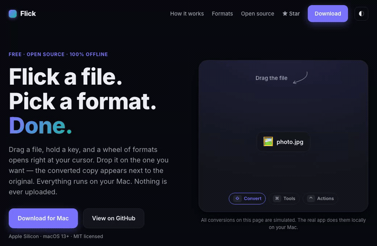

<div align="center">

# Flick

**A local, open-source file converter for macOS.**
Drag a file, hold a key, drop it on a format. Everything runs on your Mac — nothing is ever uploaded.

[Website](https://flick-mac.netlify.app) · [Download](https://github.com/SRKRZ23/flick/releases/latest) · MIT licensed

<br>



</div>

---

## What it is

Flick turns one file into another without an online uploader, an account, or a subscription.
Drag any file onto the window and a wheel of options opens:

| Key | Wheel | Does |
|-----|-------|------|
| <kbd>⇧</kbd> Shift | **Convert** | every format that file can become |
| <kbd>⌘</kbd> Command | **Tools** | compress, resize, rotate, split, mute, poster frame… |
| <kbd>⌃</kbd> Control | **Actions** | reveal, open, copy path, duplicate, extract |

Click a slice — the result lands next to the original.

## Why

Online converters make you upload a private file to a server you don't control.
Flick has no server. Every conversion is done by tools already on your machine, invoked
locally. No network, no telemetry, no account.

## Formats (v1)

Images · Video · Audio · PDF · Documents · Spreadsheets · Slides · Archives.

Flick plans a route through the installed tools, so **multi-step conversions just work** —
e.g. `DOCX → PDF → PNG` is found and run automatically as a single drop. Breadth grows by
wiring in more tools; the engine (`crates/flick-engine`) is where capabilities live.

> **Honest scope:** v1 covers the common formats in each category end-to-end. It is not yet
> a 300-format exhaustive converter — that expands incrementally.

## How it works

```
Web UI (drag + radial wheel)  ──invoke──▶  Tauri host (Rust)  ──▶  flick-engine
                                                                      │
                        RoutePlanner (cheapest ≤3-hop chain over a converter graph)
                                                                      │
             magick · ffmpeg · soffice · pandoc · pdftoppm · mutool · qpdf · gs · 7z
                              (each run as a separate child process)
```

Flick is a thin, MIT-licensed orchestrator. It never links a converter in-process, which keeps
it cleanly separate from copyleft engines. See [THIRD-PARTY-NOTICES.md](THIRD-PARTY-NOTICES.md).

## Install the conversion tools

Flick drives these CLIs. Install the ones you need (Flick shows which are present and dims
what it can't do):

```sh
brew install imagemagick ffmpeg libreoffice pandoc poppler mupdf-tools qpdf ghostscript sevenzip
```

## Build from source

Requirements: [Rust](https://rustup.rs), Node 18+ (or Bun), and Xcode **Command Line Tools**
only — no full Xcode needed (Flick uses the system WebView via Tauri).

```sh
cd app
bun install            # or: npm install  — fetches the prebuilt Tauri CLI
bun run tauri dev      # run in development
bun run tauri build    # produce a .app and .dmg in app/src-tauri/target/release/bundle
```

Run the engine's end-to-end self-test (generates real sample files and converts them):

```sh
cd app/crates/flick-engine
cargo run --example smoke
```

## Project layout

```
flick/
├── landing/            # the marketing site + in-browser demo (static, no backend)
└── app/
    ├── src/            # web UI (HTML/CSS/JS, no framework)
    ├── src-tauri/      # Tauri host: invoke commands, window, packaging
    └── crates/
        └── flick-engine/   # the conversion engine (pure Rust; orchestrates CLIs)
            ├── src/graph.rs     # the converter graph (add capabilities here)
            ├── src/planner.rs   # RoutePlanner (cheapest multi-hop route)
            └── src/exec.rs      # runs each step as a child process
```

## Signing

Release builds are ad-hoc signed and **not notarized**, so on first launch macOS may warn.
Right-click the app → **Open**, or run `xattr -dr com.apple.quarantine /Applications/Flick.app`.
Proper Developer-ID notarization is a later step.

## License

MIT © 2026 Sardor Razikov. See [LICENSE](LICENSE).
The converters Flick invokes keep their own licenses — see [THIRD-PARTY-NOTICES.md](THIRD-PARTY-NOTICES.md).
